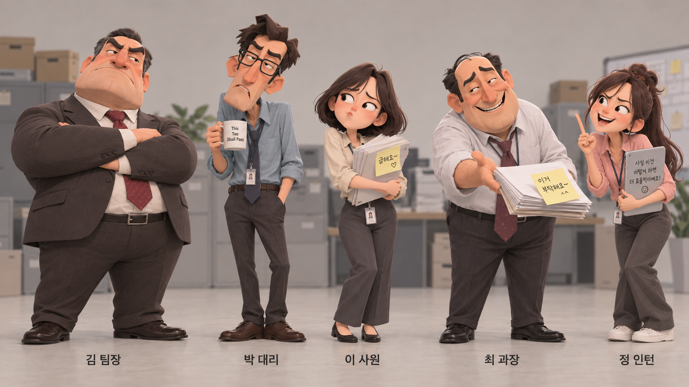

# Another Shitty Day (working title)

> 짜증나는 일상에서 시작된 소동이 끝없이 확대되는 1인칭 3D 물리 블랙코미디 샌드박스. 현재 플레이 가능 빌드는 '회사 사무실 한 층'이며 장기적으로 여러 시나리오와 협동 모드를 지향한다.

**기존 프로젝트명:** DESK BREAKER  
**현재 플레이 가능한 소스:** Godot `v0.2.2` (이 저장소에 코드 그대로 보존)  
**활성 구현 후보:** 김 팀장 3D 리깅·하이브리드 래그돌은 [Draft PR #2](https://github.com/PARK-TAEGEON/another-shitty-day/pull/2)에 opt-in 구현되고 CI 성공. **main 미병합·외형/타격감 사용자 승인 전**.

**일정 목표:** **2026-11-30 Release Phase 2 완료 → 2027년 상반기 Steam 정식 1.0(2027-06-30 목표)**. 품질 게이트를 통과하기 전 완료를 주장하지 않음.



> **중요:** 이 이미지는 승인된 **목표 아트**다. 현재 게임 속 모델이 이미지처럼 완성됐다는 뜻이 아니다. 승인된 새 5인 외형과 김 팀장 v1 시트, 래그돌 시스템은 현재 v0.2.2 게임에 적용되지 않았다.

## 먼저 읽을 문서

| 용도 | 문서 |
|---|---|
| 지금 작동하는 것과 미완료 | **[최신 작업 현황·PR/CI](docs/PROJECT-STATUS.md)** · [구버전 기준](docs/START-HERE.md) · [v0.2.2 역사 기록](docs/current-status.md) |
| 출시 목표/실행 계획 | **[2026~2027 정식 출시 로드맵](docs/RELEASE-ROADMAP.md)** · [Phase 2 이슈](https://github.com/PARK-TAEGEON/another-shitty-day/issues/5) |
| 확정한 캐릭터/게임 결정 | [10/12 결정](docs/DECISIONS-2026-10-12.md) · [10/13 확장 방향](docs/DECISIONS-2026-10-13.md) |
| 시나리오/첫 돌발행동/NPC 연쇄 반응 | [공통 시나리오 규격](docs/design/SCENARIO-FRAMEWORK.md) · [시나리오 목록](docs/design/SCENARIO-CATALOG.md) |
| Astra 기획 위임 | [Astra 전달 프롬프트](docs/HANDOFF-ASTRA-SCENARIOS-2026-10-13.md) |
| 모델링 비주얼 목표 | [아트 바이블](docs/art/ART-BIBLE.md) · [레퍼런스 등록부](docs/art/REFERENCE-MANIFEST.md) |
| 김 팀장 v2 정식 작업 지시 | [캐릭터 v2 설계 기준](docs/art/BOSS-KIM-V2-MODEL-SPEC.md) |
| 피격, 날아감, 넘어짐 구현 | [애니메이션·래그돌 설계](docs/animation-ragdoll/HYBRID-RAGDOLL.md) |
| 실제 작업 순서 및 사용자 검수 | [로드맵과 품질 게이트](docs/ROADMAP-AND-GATES.md) |
| AI/에이전트 실행 규칙 | [AGENTS.md](AGENTS.md) |
| GitHub 연결 | [원격 저장소 설정](docs/GITHUB-SETUP.md) |

## 2026-10-13 승인된 일정과 진행 방식

- **11월 30일:** 회사 사무실 한 층을 넘어 연결된 건물/사장실 특별 루트/경찰 대응까지 실제 플레이 가능한 Release Phase 2를 완료하는 목표.
- **2027년 3월 말:** 시장·공무원·교통사고·야구 등 싱글 시나리오와 은행 2인 협동을 통합하고 콘텐츠 동결 목표. 4인은 별도 검증 후.
- **2027년 6월 30일:** Steam 정식 1.0 출시 목표. 얼리 액세스는 기본 계획이 아님.
- AI 병렬 트랙(코어·아트·Astra 시나리오·멀티 스파이크·QA) 및 단일 통합 소유자, 실제 테스트·검수 근거는 [Release Roadmap](docs/RELEASE-ROADMAP.md) 참조.

## 2026-10-13 확정된 장기 방향 (기획, 미구현)

- **싱글:** 회사원·시장 자영업자·공무원·교통사고·야구 등 서로 다른 짜증나는 상황에서 시작하는 자유 난동. NPC의 얄미운 도입 대사뿐 아니라 **플레이어 첫 행동에 대한 전용 대사·몸짓·연쇄 반응**이 핵심 콘텐츠다.
- **선택형 특별 루트:** 시나리오마다 한 개 정도. 회사원은 사장실 '사장 인질극'을 예시로, 보너스 목표/분기/고득점을 검토한다. 루트를 하지 않아도 자유 플레이 가능.
- **대응 확대:** 건물 층간 이동, 경비 수색, 신고/경찰차 하차 연출, 특수부대·헬기 등은 장기 확장 후보이며 v0.2.2의 기본 경비·경찰 구현과 혼동하지 않는다.
- **멀티:** 공통 물리/NPC/경찰 시스템을 사용하는 협동 소동(은행 시나리오 예시). 네트워크 권한/물리 동기화는 별도 기술 검증 대상.
- **점수 미결정:** 현재 $ 피해액 장부는 임의의 보너스 달러를 넣지 않는다. 특별 루트의 고득점은 별도 기록 또는 실제 게임 내 손해액 반영 중 Astra가 비교 설계한다.

## 지금 게임에 있는 것 (v0.2.2)

- **한 부서 5명:** 김 팀장·박 대리·이 사원(여성)·최 과장·정 인턴(여성), 플레이어는 별도.
- **타 부서 2명**, 평소 업무·놀람·구경·겁먹음·회피와 경비의 짧은 경고·실제 제지, 후속 경찰 개입.
- 책상 양손 내려치기 **처음 B(묵직) / 반복 A(빠름)**, 주먹질·발차기·집기·던지기.
- 책상 충격 → 박 대리 “왜 그래?” → 김 팀장 가림막 빼꼼 → “뭐야 무슨 소리야?” → “이게 무슨 짓이지?” → 접근·잔소리.
- 화면 좌상단 **누적 피해액 $**, NPC 대사 자막, Esc 안의 설정/조작법.
- 물건 손상·피해액 누적·경비/경찰·제압·재시작.
- 사무실 구조 A(밀집)·B(중앙 복도)·C(순환)는 **비교 도면만 있음**. 실제 맵 교체는 미완료.

## 실행과 검사

프로젝트는 `game/project.godot`에 있다. 제작 당시 기준 엔진은 **Godot 4.7.2**이며 원본의 스크립트/리소스를 그대로 보존한다. 이 정리 작업에서는 Godot을 다시 실행하지 않았으므로 새 테스트 통과를 주장하지 않는다.

```sh
godot --path game
godot --headless --path game --editor --import
godot --headless --path game -- --smoke-test
```

Windows PowerShell 도우미: `tools/run.ps1`, `tools/test.ps1`, `tools/build.ps1`. 빌드에는 같은 버전의 Godot과 export templates가 필요하다. Windows 실행 파일은 기존 배포 ZIP에서 받을 수 있으며, **저장소에는 바이너리 배포본을 넣지 않는다.**

## 파일 구조

```text
game/                실제 Godot 게임 (기존 코드·씬 유지)
art/references/      사용자 승인/검토 중/폐기 시안 구분
blender/             향후 모델/리그 작업 규칙, 아직 .blend 없음
studies/desk-slam/   내려치기 A/B 모션 연구 (독립 Godot 스터디)
docs/                게임 설계, 아트, QA, 검증 로그, 진행 기록
tools/               기존 실행·테스트·빌드 보조 도구
licenses/            사용된 엔진·폰트의 제3자 라이선스
.github/             향후 Issue/PR 템플릿
```

## 변경·권리 상태

- 이 저장소의 **기본 Git 커밋은 v0.2.2 ZIP에서 재구성한 스냅샷**이다. 원 소스에 적힌 과거 커밋 SHA를 실제 Git 이력으로 복원한 것은 아니다. [원본 확인](docs/IMPORT-PROVENANCE.md)
- 승인된 외형 시안은 게임용 메시/리그가 아닌 이미지 자료다.
- 게임 코드의 공개·상업 재배포 라이선스는 아직 정하지 않았다. 외부 에셋의 권리·출처는 개별로 기록한다. [권리 및 배포 정책](licenses/PROJECT-LICENSE-STATUS.md)
- GitHub 원격 저장소 **`PARK-TAEGEON/another-shitty-day`가 현재 존재**한다. `docs/GITHUB-SETUP.md` 및 과거 로그의 '미생성' 문구는 당시 시점의 기록이다.
