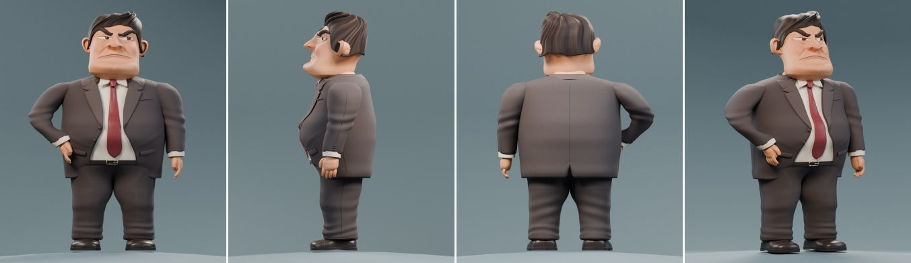

# 김부장 외형 실험 01



저장소에서 ‘김 팀장’으로 부르는 인물의 새 외형 후보. GPT가 작성한 Blender Python으로 빈 장면에서 조형했다. 게임에 들어간 기존 캐릭터는 동작 비교용 기준으로 보존했다.

[Blender 원본](boss_kim.blend) · [생성 스크립트](build.py) · [정면](front.png) · [측면](profile.png) · [후면](back.png) · [3/4](three_quarter.png) · [얼굴 확대](portrait.png)

## 어느 원화를 기준으로 삼았나

- [승인된 5인 라인업](../../../art/references/approved/five-staff-unlikable-approved.png)의 맨 왼쪽 인물을 외형 기준으로 삼았다. 관자놀이보다 넓은 턱, 한쪽을 흘기는 눈, 거꾸로 올라가는 눈썹 끝, 뒤로 넘긴 어두운 머리, 벌어진 차콜 재킷과 적갈색 넥타이가 식별점이다.
- [초기 사무실 원화](../../../art/references/approved/office-caricature-original.png)는 성인 풍자 캐리커처의 면 처리와 과장 정도를 보여 준다. 옷차림과 색상에는 최신 라인업을 적용했다.
- [김 팀장 단독 시트](../../../art/references/concept-wip/boss-kim-turnaround-v1-concept.png)는 뒤통수·재킷 뒤트임·구두·입매를 해석할 때 사용했다. 등록 상태는 concept-wip이며 팔짱과 원근 때문에 정밀 치수의 근거로 쓰기 어렵다.
- 이번 자세는 한 손을 허리 옆에 둔다. 원화에서 팔짱에 가린 재킷 앞판, 배 돌출과 허리선을 네 방향에서 검수하려는 제작상 선택이다.

## 기존 모델과 달라진 부분

기준 커밋은 `main`의 `95cc0c9`다. [기존 생성 스크립트](../../build_boss_kim.py)는 몸통 단면과 연속 소매를 생성하고 면판·타원체·튜브를 덧붙인 다음 웨이트를 배정한다. [빌드 기록](../../boss_kim/build-report.json)에는 70개 파트, 13,884삼각형, 31개 본, 5개 모션이 있다. 기존 GLB를 Blender에서 읽어 캐릭터 메시의 정점 7,092개, 재질 슬롯 12개와 31개 본을 대조했다. 기존 `.blend` 헤더는 5.2 형식이고, 이 실험의 Blender 4.3.2에서는 직접 열리지 않아 GLB와 [실제 게임 캡처](../../../docs/evidence/kim-2026-10-13/kim-turnaround-comparison.png)를 외형 비교에 사용했다.

| 부위 | 기존 구현과 관찰 | 이번 제작 방식 |
| --- | --- | --- |
| 얼굴 | 넓은 턱의 단면은 있지만 타원체 코끝·콧대, 튜브 입술과 주름의 경계가 측면에서 두드러진다. | 하나의 조밀한 얼굴 표면에 안와·광대·콧등·콧방울·입술·턱밑의 깊이를 조형했다. 눈꺼풀과 홍채는 같은 눈 표면을 따라간다. |
| 머리 | 모자 모양 바탕에 일곱 개의 비슷한 머리 다발을 올렸다. 정면에서는 다발 끝이 반복된다. | 앞 이마·구레나룻·목덜미의 경계를 따로 설계했다. 비대칭으로 돌아가는 두피 표면에 굵은 다발과 가는 빗결을 함께 새겼다. |
| 정장 | 닫힌 재킷 위에 폭이 일정한 셔츠 띠와 별도 라펠을 얹어서 측면에서 층이 벌어진다. | 열린 재킷의 절개선·두께·뒤트임을 만들고, 배 곡면으로 라펠과 주머니의 위치를 계산했다. 바지는 두 다리가 샅에서 만나 허리까지 이어진다. |
| 체형과 자세 | 실제 캡처에서는 직선에 가까운 바지와 어깨가 강하고 복부의 앞뒤 차이가 작다. | 짧은 다리, 묵직한 턱, 배의 정점, 뒤로 젖힌 머리 각도와 짝자세로 성격을 표현했다. |

## 시각 검수

| 첫 실험 기준 | 확인 결과 |
| --- | --- |
| 정면 전신과 얼굴 확대에서 눈썹·시선·입매를 읽을 수 있는가 | 확대에서 곁눈질과 다문 입이 보인다. 최종 전신 PNG를 높이 180px로 축소해 확인했다. 눈썹·턱·실루엣은 읽히지만 동공 방향은 약하다. |
| 측면에서 턱, 가슴, 배의 윤곽이 구분되는가 | 들린 턱 아래로 목이 들어가고 가슴 아래에서 배가 나온다. 셔츠·타이는 곡면을 따라간다. |
| 후면과 3/4에서 옷과 머리의 연결이 유지되는가 | 최종 프레임에서 뒤 중심 솔기와 트임, 샅과 허리의 연결, 귀 뒤에서 목덜미로 이어지는 머리 경계를 확인했다. |
| 같은 원본으로 네 시점이 재현되는가 | 전신 카메라 네 대가 직교 배율 2.30을 공유한다. 정면·측면·후면은 수평이고 3/4는 방위각 −32°, 고도 3°다. 전신·확대 모두 960 × 1120 Cycles 렌더다. |

첫 렌더의 주광을 가린 배경을 고치고 턱 뒤쪽을 좁혔다. 다음 렌더에서는 띠처럼 보이던 바지 주름을 줄이고, 사타구니에 겹치던 조각을 한 메시로 연결했다. 최종 확대 검수에서는 콧방울 밑면, 귀 뒤쪽과 머리 빗결을 다듬었다.

**판정은 정적 외형 후보 제작 성공, 상업용 최종 아트 적합성 보류다.** 원화보다 눈두덩과 볼살이 팽팽하고 머리의 큰 덩어리가 강하다. 실제 사무실 거리에서의 캐릭터 식별과 사용자의 원화 일치도 평가는 열려 있다.

## 원본 검증과 재생성

Blender 4.3.2의 새 프로세스에서 저장본을 다시 열어 측정하고, 기본 3/4 카메라의 축소 렌더도 다시 출력해 구도와 외형을 대조했다. 스튜디오를 제외한 캐릭터는 149개 메시 오브젝트, 기본 정점 126,552개, 모디파이어 평가 후 407,588삼각형이다. 높이는 약 2.092m다. 원본은 외부 텍스처나 링크된 Blender 파일 없이 열린다. Armature와 Action은 각각 0개다. 게임용 폴리곤 예산, Godot 재질과 성능, 변형은 후속 검증 대상이다.

Blender에서 원본을 열면 3/4 카메라가 기본이다. Scene Properties의 Camera에서 다섯 카메라 중 하나를 고른 뒤 F12로 해당 시점을 렌더할 수 있다. 터미널에서는 이 폴더에서 다음 명령으로 별도 디렉터리에 원본과 이미지를 재생성한다.

```bash
blender -b --python-exit-code 1 --python build.py -- --out ./rebuild --quality final
```
