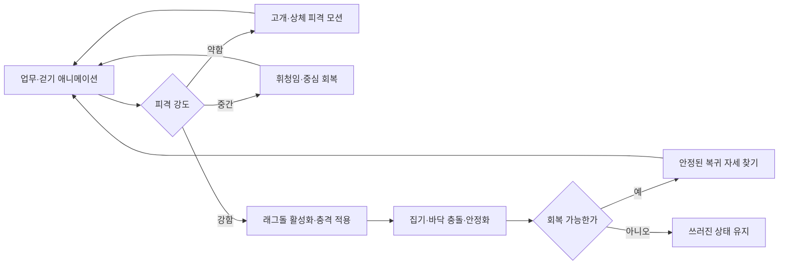

# 피격·비행·낙하: 하이브리드 애니메이션/래그돌 구현 설계

**상태:** 기술 설계 / Godot 미구현. 먼저 김 팀장 1명으로 증명한 뒤 확대한다.

## 왜 혼합 방식인가

작은 피격까지 모든 상황에서 래그돌을 실행하면 인형처럼 힘없이 무너진다. 모든 낙하를 고정 애니메이션으로 처리하면 가구·책상에 부딪히는 위치가 어색해진다. 기본 동작은 애니메이션, 강한 충격은 물리 몸체로 전환해 재생성을 확보한다.

## NPC 상태 흐름

## 기술 자산

- **Blender Mesh + Armature:** 스키닝과 충분한 관절 변형. 팔·다리가 단순 부품처럼 분리되어 보이면 안 된다.
- **Godot Skeleton3D / PhysicalBoneSimulator3D / PhysicalBone3D:** 골반·흉곽·머리·위아래 팔·위아래 다리의 충돌체, 질량 분포, 회전 제한 구성.
- **NPC CharacterBody3D + 물리 전환:** 충격이 큰 순간 캐릭터 이동 제어를 중지하고 본/물리 시뮬레이션 주도권으로 전환한다. 루트 변환 일치를 유지하여 화면 순간이동 방지.
- **RigidBody3D 집기:** 의자, 이동 가능한 소품과 충돌 레이어, 최대 속도, 중복 피해액 계산 방지.
- **AnimationTree / 피격 애니메이션:** 방향에 따라 고개·상체가 돌아가는 약한 피격 모션, 표정 변화와 타격음을 분리.

## 제안 충격 등급

| 등급 | 예 | 추천 반응 | 검수 |
|---|---|---|---|
| Light | 일반 주먹이 스치듯 적중 | 고개/몸통 반응·단발 소리 | 계속 걷거나 다음 행동 가능 |
| Medium | 강한 주먹·가벼운 소품 | 몇 걸음 휘청·균형 회복, 필요 시 부분 래그돌 실험 | 수 초마다 불합리한 넉다운 발생 금지 |
| Heavy | 강한 발차기·무거운 물건 충돌 | 짧은 반응 애니메이션 이후 전신 래그돌, 접촉 방향에 맞는 충격 | 바닥·의자·책상과의 접촉이 자연스러움 |

**숫자 충격량/질량은 실측 전 미정**이다. 애니메이션과 실제 물리 임펄스가 같은 프레임에 중복 적용되지 않도록 입력/상태 경계를 명시한다.

## 물리 검수 우선순위

1. 김 팀장 몸통 타격 후 골반·가슴 충돌체가 카메라와 물건을 통과하지 않는가.
2. 피격 방향이 정면/측면/뒤에서 일관된가. 머리·척추·무릎이 불가능한 방향으로 접히지 않는가.
3. 책상 위 물체나 의자를 쳤을 때 의자 움직임·종이 날림이 **한 충격에서 자연스럽게 이어지는가.**
4. 바닥에 누웠다가 일어나는 경우, 래그돌 마지막 골반 자세에서 회복 애니메이션으로 부드럽게 섞이는가.
5. 넘어짐 후 손발이 심하게 떨리지 않는가, 프레임마다 과도한 물리 관절 솔버 비용이 발생하지 않는가.
6. 플레이어가 상사를 연속 타격해도 기존 대사/상태가 어긋나지 않는가.
7. 출동 중 NPC·경비·경찰의 수가 늘어도 목표 PC에서 60fps를 지향하는가 (확정 성능 보장 아님).

## 물리 테스트장 구성

`game/tests/ragdoll_lab.tscn` 예정 (현재 없음): 평평한 바닥, 김 팀장, 책상, 의자, 던질 수 있는 소품, 타격 위치/방향 설정, 임펄스 수치 조절, 무한 반복 테스트 버튼. 게임 본편에 통합하기 전에 **테스트장만으로 약함/강함/가구 충돌 3종의 영상**을 검수한다.

## 시각 방향

현실적인 상처나 고어보다 우스꽝스러운 당황과 균형 무너짐, 의자와 엉킴, 넥타이·서류가 흔들리는 연출에 집중한다.
