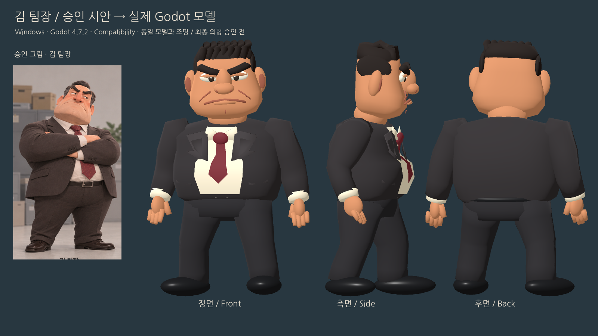

# 김 팀장 Vertical Slice — 실제 구현과 검증

2026-10-13 KST. **IMPLEMENTED / 기술 검증 완료 / 외형·타격감 승인 전.**
연구 PR #1의 46/46 애니메이션 및 15/15 데모 래그돌 결과를 재사용했다.
이번 시험은 새로 제작한 **김 팀장 자체 모델**의 통합 시험이다.
나머지 네 직원은 교체하지 않았다. `main`에 병합하지 않았다.

## 실행

기본 설정 `asd/characters/kim_rig_enabled=false`를 유지한다.

```text
godot --path game -- --kim-rig
godot --path game res://tests/ragdoll_lab.tscn
```

테스트장: 1 Light, 2 Medium, 3 Heavy, 방향키 타격 방향, R 새 캐릭터.
본편: 기존 F/주먹/Q/집기/R 조작 그대로. 프로젝트 설정으로 활성화할 수도 있다.
독립 Windows 빌드는 실행 파일에 `-- --kim-rig`를 전달한다.

## 제작된 파일

- `blender/boss_kim/boss_kim.blend`: 승인 이미지가 내장된 편집 가능한 원본. 개별 의상·얼굴 파트, A포즈 Armature, 웨이트, 5개 변환 모션, 4개 변형 검사 포즈.
- `blender/build_boss_kim.py`: 재현 가능한 Blender 제작·리타게팅·내보내기 도구. `--ual`에 PR #1에서 검증한 무료 Standard GLB를 전달한다.
- `game/assets/characters/boss_kim/boss_kim.glb`: 김 팀장 전용 메시. 스톡 모델 지오메트리는 포함하지 않는다. 31본, 약 13.9k 삼각형, 하나의 스킨 메시/12개 재질 표면. 웨이트 합 오차 < 3e-8.
- `game/scripts/characters/kim_visual_adapter.gd`: 기존 컨트롤 포즈와 Skeleton3D 연결, 세 단계 반응, 물리 전환, 접촉음.
- `game/scripts/characters/kim_physical_bone.gd`: 기존 `receive_hit(impulse, point, damage)`를 부모 NPC로 전달.
- `game/tests/ragdoll_lab.tscn`: 바닥·책상·기존 RigidBody 의자가 있는 독립 테스트장.
- `tools/test-kim.ps1`: 새 검사 2종과 기존 회귀 검사 10종, 모두 기능 ON.

## 아트·리그 기준 / 다른 직원에 재사용

기준은 `art/references/approved/five-staff-unlikable-approved.png`의 첫 번째 인물이다.
차콜 정장, 아이보리 셔츠, 짙은 적색 넥타이, 큰 사각 턱, 굵은 눈썹, 돌출된 배를 직접 모델링했다.
승인된 그림의 세밀한 표면·헤어·표정 품질을 그대로 달성했다고 주장하지 않는다.
현재 렌더는 저폴리 구현 검수 후보이며, 최종 표면 마감과 얼굴 표현은 후속 조정 대상이다.

| 기준 | 김 팀장 현재 값 / 재사용 규칙 |
|---|---|
| 좌표 | 미터, Blender Z-up / -Y 전방 → Godot Y-up / +Z 전방 |
| 원점 | 양발 사이 바닥. Root의 위치·스케일 애니메이션을 이동에 사용하지 않음 |
| 비율 | 높이 약 2.22m, 골반 .84m, 무릎 .46m, 발목 .12m, 어깨 1.47m, 머리 본 1.64m |
| 몸통 | Root → Pelvis → Spine → Chest → Neck → Head; Jaw/Brow.L/Brow.R는 표정 전용 |
| 팔 | Chest → UpperArm.L/R → Forearm.L/R → Hand.L/R → Finger0..3.L/R, Thumb.L/R |
| 다리 | Pelvis → UpperLeg.L/R → LowerLeg.L/R → Foot.L/R |
| 바인드 | A포즈. 모든 변형 본의 스케일 1. 이름 공유, 체형별 rest 위치와 웨이트는 새로 맞춤 |
| 스키닝 | 몸통·팔꿈치·무릎은 연속된 면과 보간 웨이트. 소품/눈/머리는 해당 본에 부착 |
| 물리 | 골반·가슴·머리 + 양팔 6 + 양다리 6 = 15 몸체. 체형별 질량·캡슐·관절 제한 조정 필수 |
| 검수 | 새 직원마다 변형 렌더, 전/측/후 반복 물리, 본편 회귀를 다시 실행. 김 팀장 승인을 복제하지 않음 |

모션 변환은 원본의 전역 회전 변화량을 대상 T-neutral 방향에 적용한 뒤 **대상의 A rest에 대한 로컬 회전**으로 다시 계산한다. 단순히 이름만 바꾸거나 원본 골반 높이를 복사하지 않는다. Idle, Walk, Idle_Talking, Hit_Head, Hit_Chest를 30fps로 베이크했다. 원본 루트 이동은 사용하지 않는다.

기존 빼꼼 높이·시각, 이동 후 실제 거리 기반 보행, `question/admonish/insist`, 손목/손가락 및 고개 추적을 원래 코드에서 계산한다. 새 어댑터는 이 포즈를 골격으로 옮긴다. 기존 절차적 모델은 숨겨진 컨트롤로 남기므로 행동 타이밍과 회귀 검사를 유지한다. 일반 대기·대화에는 UAL을 사용하며 승인된 접근 보행을 범용 Walk로 덮어쓰지 않는다. Walk 리타게팅 자체는 파일/변형 검사에 포함한다.

## 피격·물리·회계 경계

- Light: 임펄스 크기 <8.5. 고개/가슴 피격, 0.42초 후 기본 포즈.
- Medium: 8.5 이상, 11.5 미만. 방향성 몸통 휘청임과 1.05초 회복. 기존 CharacterBody 이동/중력 유지.
- Heavy: 11.5 이상 또는 기존 체력 소진. `down`으로 한 번 전환하고 15본 시뮬레이션 시작. 일반 주먹은 약 7.28, 발차기는 약 13.15.
- Heavy는 ON 모드에서 첫 강한 발차기만으로 넉다운할 수 있다. 이 차이는 의도된 새 기능이다. OFF 모드의 체력 규칙은 그대로다.
- 전환 직전 스켈레톤 포즈/월드 변환을 전달하고, CharacterBody의 layer/mask를 즉시 0으로 바꾼다. 콜리전 shape 비활성화는 지연 적용한다. 레거시 납작한 박스/통째 회전/캐릭터 이동은 실행하지 않는다.
- 물리본 layer=4, mask=11: 바닥/가구/플레이어와 충돌, 본끼리 자기 충돌은 제외. 기존 공격 ray mask=7로 실제 팔다리를 다시 공격할 수 있다.
- 충격은 가장 가까운 본에 월드 방향과 제한된 지렛팔로 적용한다. 입력 22, 지렛팔 .25m 상한. 물리 크기 보정 2.5배는 전체 힘의 한 번 적용이며 중복 타격이 아니다.
- 관절은 제한된 ConeTwist. 현재는 모든 관절의 완전한 해부학적 힌지 해법이 아니므로 극한 자세의 시각 마감은 남아 있다.
- 반복 타격은 물리 임펄스만 더한다. ASSAULT/KNOCKDOWN/치료·업무 손실은 기존 NPC 코드에서만 발생한다. 가구의 가격·파손·충돌 판정 코드는 변경하지 않았다.
- Heavy 이후 자동 일어나기/물리→애니메이션 복귀는 **미구현**. 쓰러진 채 유지하며 재시작으로 초기화한다.

## 실제 검증 결과

| 검사 | 결과와 범위 |
|---|---|
| Godot 4.7.2 임포트·스크립트 | PASS, 최종 검사 로그의 스크립트/임포트 ERROR 없음 |
| Blender 출력 | PASS, .blend 저장 + GLB 내보내기 + Godot 재수입. 31본/5모션/4검사 포즈 |
| 리타게팅 수치 | PASS, 9클립의 유한 본 변환 및 단위 스케일. 관절별 미세한 실루엣 품질은 렌더로 별도 검수 |
| 새 김 팀장 전/측/후 물리 | PASS, 각 10회 총 30회. 낙하·방향 이동·유한 위치/속도·몸체 간 최대 거리·바닥 관통 기준 검사 |
| 책상·의자 | PASS, 실제 PhysicalBone 접촉 ID와 의자 이동 기록. `kim-physics-report.json` |
| Light/Medium | PASS, 비넉다운과 반응 종료 확인 |
| 연속 타격/회계 | PASS, 각 시나리오 최초 사건 1회, 추가 물리 타격 3회에 재청구 없음 |
| 실제 장면 재시작 | PASS, 메인 tscn 실제 reload 5회. 활성/지연 물리 전환 모두 검사. NPC 7명, 새 라운드 피해액 0 |
| 기존 게임 OFF | PASS, 기존 import/smoke + 10종 회귀 전체 |
| 기존 게임 ON | PASS, 기존 10종 + 새 2종 회귀. 첫 B/반복 A, 빼꼼/접근/대사, 경비·경찰, 가격·손상, HUD/초기화 포함 |
| 실제 Windows release | PASS, 공식 템플릿 export 후 기본/ON 모드 모두 GTX 1660 SUPER OpenGL에서 스모크 성공 |
| 실제 렌더 | CAPTURED & REVIEWED, 회전 비교·관절 변형·28초 본편/25초 테스트장. AI 콘셉트 영상이 아님 |
| 음향 | 물리 접촉 이벤트 검사 + 실제 영상 음향 트랙 포함. 주관적 믹스/청감 승인 NOT VERIFIED |
| 목표 PC 60fps 지속 부하 | NOT VERIFIED. Movie Maker의 CPU/GPU 시간은 정상 플레이 FPS 벤치마크가 아님 |
| 사용자 스타일/재미 승인 | NOT VERIFIED, 이번 결과물의 두 검수 항목 |

기존 회귀 일부는 종료 시 ObjectDB 경고를 출력한다. PASS는 성공 마커·0 종료 코드·SCRIPT ERROR/ERROR 없음 기준이며, 기존 경고가 없었다고 주장하지 않는다.

## 실제 화면과 영상



- [28초 실제 사무실 연속 시연](../evidence/kim-2026-10-13/kim-office-28s.mp4): 업무 → 첫 B → 빼꼼 → 접근 → 세 잔소리 → 실제 주먹/발차기 → 래그돌.
- [25초 테스트장 연속 시연](../evidence/kim-2026-10-13/kim-lab-25s.mp4): Light/Medium/Heavy, 방향별 초기화, 의자·책상 주변 낙하.
- [관절 변형 렌더](../evidence/kim-2026-10-13/kim-deformation-check.png).
- [검증 원본 기록](../evidence/kim-2026-10-13/): 회귀·Windows·물리 JSON·촬영 로그.

본편 영상은 실제 `player.perform_action()`과 기존 판정을 사용한 자동 입력 재생이다. 촬영용 카메라 추적만 추가했다. 테스트장 영상에는 방향 비교를 위한 명시적인 캐릭터 초기화가 있다. 시간 압축이나 생성된 프레임 보간은 없다.

## 외부 권리와 소품 범위

- Quaternius UAL Standard: **CC0**, [공식 배포](https://store.godotengine.org/asset/quaternius/universal-animation-library/). 재배포된 것은 새 모델에 변환한 모션이며 원본 마네킹 메시를 포함하지 않는다. `licenses/third-party/Quaternius-UAL-CC0.txt`.
- Kenney Impact Sounds 1.0: **CC0**, [공식 배포](https://kenney.nl/assets/impact-sounds). `impactSoft_heavy_000.ogg`, `impactWood_medium_000.ogg`만 사용. `licenses/third-party/Kenney-Impact-CC0.txt`. 골반·가슴·머리 접촉의 최소 속도/0.22초 공통 쿨다운으로 과도한 반복음을 막는다. 소리는 회계·소동 이벤트를 발생시키지 않는다.
- 원본 아카이브 SHA256: UAL `18ff1a7215f4852b320203e8aaf02a1578b5c8eef9027fbaedfcedc7b85a3ac2`; Kenney `029d734af1582474edf3a694d1b0cebc97c1c152f2f39fa34d4c2bafc5de77f8`.
- Godot 공식 데모의 CC BY 마네킹/모델/텍스처는 이번 게임·Blender 파일에 포함하지 않는다.
- 기존 의자·컵·서류 외형/파손 연출을 유지하고 실제 래그돌 접촉을 연결했다. CC0 가구로 전면 교체하거나 추가 소품 외형을 제작한 단계는 **미완료**다. 김 팀장 외형 게이트 뒤로 남겼다.

## 남은 작업 / 완료 주장 범위

**완료:** 한 명의 플레이 가능한 opt-in 기술 Slice, 원본 모델과 제작 도구, 애니메이션 변환, 하이브리드 물리, 실제 영상, 재현 시험, Windows 빌드.

**미완료:** 승인 시안 수준의 최종 얼굴/헤어/의상 미술 마감, 극단 관절 포즈의 정밀 해부학 제한 및 근접 관통 마감, 자동 일어나기, 추가 가구 외형 개선, 장시간 성능·수동 플레이 검수. 나머지 4명 제작은 시작하지 않았다.

사용자에게 필요한 판단은 **인게임 그림체/실루엣**과 **피격·낙하·가구 접촉의 코미디/타격감** 두 가지다. 기술 체크리스트를 사용자에게 대신 수행하도록 요구하지 않는다.
