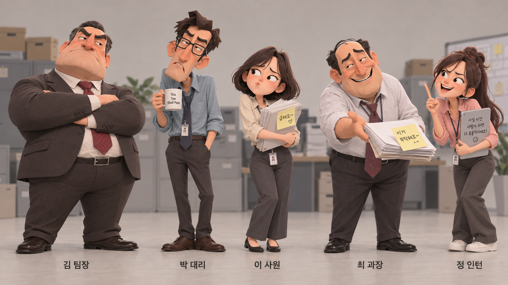

# 아트 바이블: 풍자 만화형 사무실

## 기준 시각 자료

- **최신 캐릭터 기준:** `art/references/approved/five-staff-unlikable-approved.png`
- **기존 사무실·손 스타일 기반:** `art/references/office-caricature-approved.png`
- **김 팀장 임시 정면/측면/후면/표정 시트:** `art/references/concept-wip/boss-kim-turnaround-v1-concept.png`
- **폐기된 실사풍:** `art/references/exploration/` (프로덕션에 쓰지 않음)

## 스타일 규칙

- 큰 코·턱·눈썹과 일부러 삐뚤어진 체형, 두툼한 덩어리와 절제된 얼굴 면.
- 피부와 옷은 무광/반무광, 머리카락은 많은 가닥 대신 큼직한 덩어리로 표현.
- 눈·표정은 선명하되 유아용 마스코트나 실사 인간처럼 만들지 않는다.
- NPC를 멀리서도 구별할 수 있어야 하며 외형은 서로 다른 불쾌한 업무 습관을 반영한다.
- 피격 연출은 희극적 과장: 불균형, 회전, 의자에 엉킴, 서류 흩어짐. 고어·현실적인 상해 표현은 우선 목표가 아님.
- 사무실은 과장된 캐릭터를 받치는 중립 색감. 베이지·회청색·회색 파티션, 먼지 낀 조명·생활 집기. 지나치게 미려한 고급 오피스 금지.

## 부서 5명

| 배역 | 실루엣과 얼굴 | 행동에서 드러낼 불쾌함 |
|---|---|---|
| 김 팀장 | 크고 사각진 턱, 두꺼운 눈썹, 무겁고 배 나온 체형 | 턱 들고 팔짱, 고압적인 접근·지적 |
| 박 대리 | 가늘고 긴 얼굴, 돌출 코, 각진 안경, 굽은 자세 | 비꼬는 표정, 커피 들고 빈정댐 |
| 이 사원(여) | 단발, 작고 기민한 자세, 얄미운 곁눈질 | 순진한 척 책임을 넘김 |
| 최 과장 | 밀리는 헤어라인, 둥근 얼굴, 부담스러운 웃음 | 서류를 밀어주며 일을 떠넘김 |
| 정 인턴(여) | 묶은 머리, 쏟아지는 말, 앞으로 쏠린 자세 | 자신만만하지만 쓸모없는 조언 |

## 3D 구현 원칙

캐릭터 체형과 머리 크기를 표준 휴머노이드 하나로 강제로 맞추지 않는다. **뼈대 이름은 공유하고 각 체형에 맞게 메시/캡슐/관절 제한을 조정**한다. 손목·팔꿈치·어깨·목은 평상시뿐 아니라 피격 테스트에서도 메시가 관통하거나 꺾여 보이지 않아야 한다.
