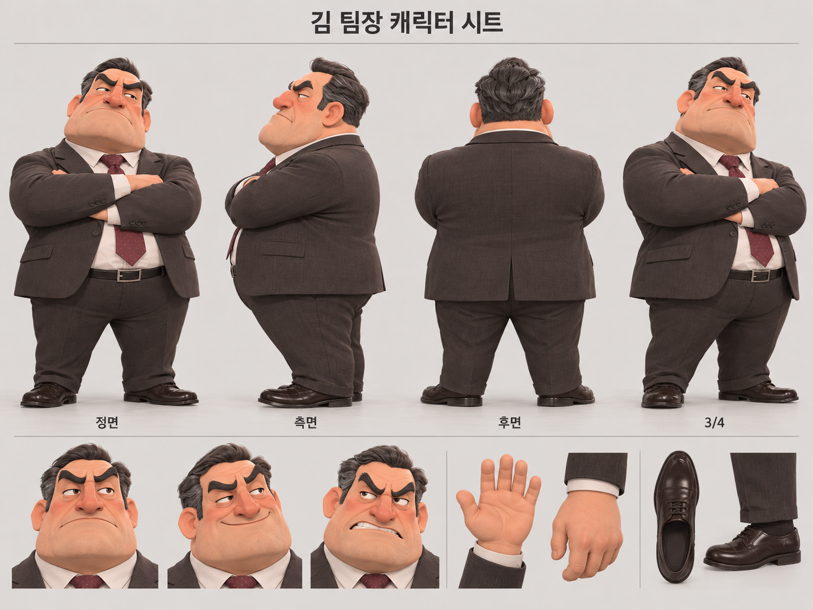

# 김 팀장: Blender 투입용 설계도 v2 제작 규격 (아직 제작 전)

## 왜 새 시트가 필요한가

v1은 인상이 좋은 컨셉 이미지이나, 팔짱 낀 자세와 완전하지 않은 직교 투영으로 인해 모델링·스키닝의 정확한 기준이 아니다. **v1을 기계적인 정답 측정 도면으로 쓰지 않는다.**

## v2 최소 산출물

1. **정면/좌측 90°/후면 직교** A포즈 전신. 같은 키·어깨·골반·발 위치를 가로 가이드로 정렬. 렌즈 왜곡·원근 차이 없음.
2. **3/4 성격 시안** 별도. 평상시·비웃음·꾸짖음·놀람의 얼굴 4종 확대.
3. **리깅 기준선:** 목, 어깨, 팔꿈치, 손목, 엉덩이, 무릎, 발목, 골반과 척추의 굽힘 위치. 얼굴 눈꺼풀/눈썹/턱 회전 기준.
4. **의상 분해:** 재킷, 셔츠, 넥타이, 바지, 구두, 팔과 손. 관절 주변의 착용 구조와 필요한 뒷면 표시.
5. **색/재질표:** 차콜 재킷, 다크 레드 넥타이, 아이보리 셔츠, 무광 피부, 머리카락/구두 표면 및 각 질감 참고.
6. **치수표 초안:** 전체 키, 머리·어깨·골반·다리의 상대 크기, 배 돌출 및 팔뚝 둘레. 숫자는 모델이 실제 책상/문/바닥과 맞는지 확인 후 확정.
7. **표정 및 래그돌 변형 참고:** 턱/목 회전, 등 굽힘, 팔 벌림, 넘어졌을 때 옷이 찢어져 보이지 않는 구조.

## Blender 제작 기준

- A포즈(팔 약간 벌림, 손가락 펼침)를 메인 바인드 포즈로 설정. 팔짱은 추후 행동 애니메이션으로 별도 제작.
- 캐릭터 단위는 미터, 바닥 `Z=0`, 몸의 중심과 앞 방향 정의를 프로젝트와 통일. glTF export 전에 변환 스케일/회전 정리.
- 최소 공통 골격: Root/Pelvis/Spine/Chest/Neck/Head, UpperArm/Forearm/Hand L/R, UpperLeg/LowerLeg/Foot L/R. 얼굴 표정은 Bone 또는 Shape Key 중 구현 가능한 수단으로 선택.
- 디포메이션 테스트: 양팔 들기, 책상 위 손 내밀기, 상체 전·후굴, 고개 60도 돌리기, 90도 무릎 굽히기. 관통·비틀림 평가.
- 게임용 메시/리그 아트폴더에 `.blend`, `.glb`, 사용한 텍스처·재질을 저장한다. 현재는 **어떤 파일도 제작 완료로 간주하지 않는다.**

## 사용자 검수 게이트

**① 실루엣:** 정면·측면에서 ‘얄미운 김 팀장’으로 보이는가? **② 표정:** 말하지 않아도 건방짐이 보이는가? **③ 동작:** 팔꿈치·목·턱을 굽혀도 모델이 유지되는가?
