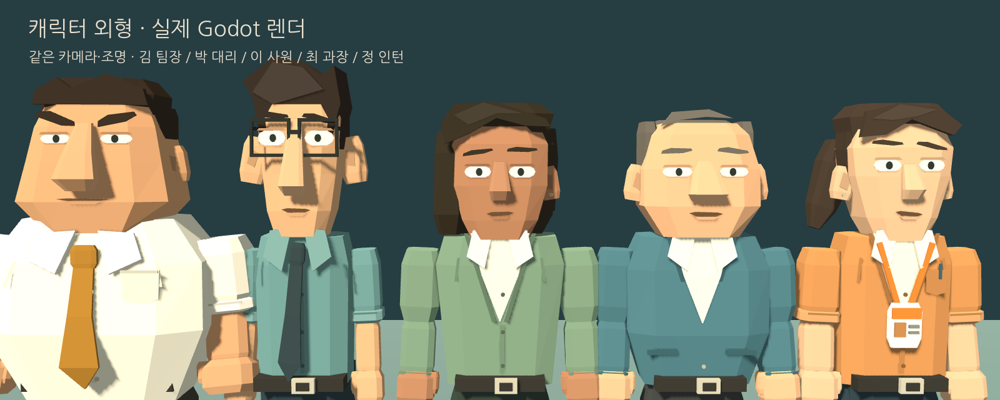
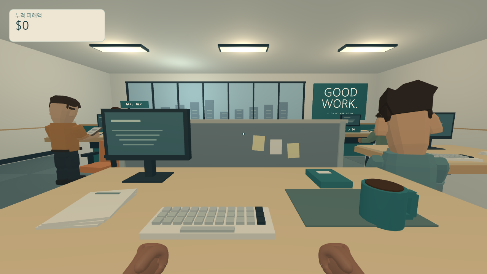
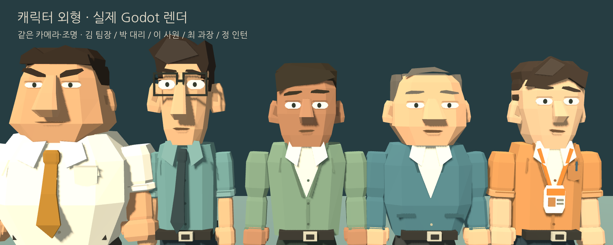

# DESK BREAKER — 현재 상태

기준일: 2026-10-11 · 현재 작업: **v0.2.2** · 단계: **여성 직원 두 명 적용·화면 확인·기본 빌드 검사 완료 / 사무실 구조 선택 대기**

## v0.2.2 이번 패치 — 여성 직원 두 명

사용자는 기존 직원 두 명 정도를 여성으로 바꾸도록 요청했다(D022). 이번 패치에서 **이 사원과 정 인턴을 성인 여성 직원으로 변경**했다. 두 배역의 선택과 구체적인 외형은 제작 판단이며, 사용자 지정 이름·디자인으로 기록하지 않는다.

| 대상 | v0.2.2 적용 외형 | 기존 역할 |
|---|---|---|
| 이 사원 · 여성 | 정돈된 단발, 각진 얼굴과 기존 사무복의 큰 면 | 타이핑, 일을 떠넘기는 후배의 말투, 굳음·회피 |
| 정 인턴 · 여성 | 묶은 머리, 좁은 턱, 주황색 옷·인턴 출입증·서류 | 서류 확인, 아는 척하는 말투, 당황·회피 |

김 팀장·박 대리·최 과장의 기존 외형과 역할, 같은 부서 5명·타 부서 2명의 구성, 수용된 첫 반응·접근·잔소리, 양손·조작·피해액·경비 대응과 v0.2.1의 간결한 달러 HUD를 유지한다. 사무실 A/B/C는 아직 선택 전이며 현재 플레이 맵은 기존 배치다.

[이 사원 타이핑·대사](preview/female-cast-junior-working.png) · [정 인턴 서류 확인·대사](preview/female-cast-intern-working.png) · [현재 사무실](preview/female-cast-office.png)

### v0.2.2에서 확인한 범위

두 모델의 변경과 실제 화면 확인을 마쳤다. **실제 사무실에서 카메라만 옮긴 검수**로 여성 배역이 정확히 두 명인 구성, 이 사원의 타이핑과 정 인턴의 서류 확인, 각자의 기존 대사를 확인했다. 나머지 김 팀장·박 대리·최 과장은 같은 카메라·조명 조건의 수정 전후 PNG가 바이트 단위로 동일하다. 실제 업무 화면과 모델 비교 화면을 사용했으며 새 사무실 구조를 적용한 화면은 아니다.

| 이번 확인 | 실제 결과 |
|---|---|
| import | Godot 4.7.2에서 최종 스크립트와 리소스 가져오기를 통과했다. |
| 소스 기본 실행 | 7명 구성·도달 거리·실제 업무/기물/출동 장부·비용과 대응 분리·집기·결과 고정·초기화의 smoke를 통과했다. |
| Windows 내보내기 | x86_64 EXE와 내장 PCK를 생성했다. |
| 내장 데이터 기본 실행 | 소스가 없는 별도 폴더에서 **Linux Godot로 EXE 내장 PCK**의 smoke를 통과했다. Windows 네이티브 실행은 아니다. |

소스 smoke에는 기존 **ObjectDB 인스턴스 10개가 종료 때 남았다는 경고 1건**이 있다. 나머지 import·Windows export·내장 PCK smoke의 세 빌드 검사에는 경고가 없다. 가상 디스플레이에서 V-Sync를 설정할 수 없다는 경고는 실제 렌더 로그에 보존했다. 상세 명령·결과·이미지·로그는 [v0.2.2 여성 배역 변경 빌드 기록](female-cast-build-report.json)을 따른다.

**이번 미실행 범위:** 전체 회귀 검사, Windows 네이티브 실행, PowerShell 래퍼, 목표 PC의 조작감·소리·성능 검사. 앞선 v0.2.1의 다섯 회귀 검사와 v0.2.0의 아홉 회귀 결과를 이번 버전의 재실행 결과로 취급하지 않는다. 이번 패치는 추가 게임 기능·새 맵·최종 Blender 모델·리깅을 포함하지 않는다.

### v0.2.2 전달 구성과 다음 검수

| 전달 파일 | 내용 |
|---|---|
| `DeskBreaker-Windows.zip` | v0.2.2 실행 파일·첫 플레이 안내·빌드 기록·소스 커밋·라이선스 |
| `DeskBreaker-source-female-cast.zip` | 두 배역의 모델 변경, 실제 화면·검증 로그·최신 문서와 기존 구조 비교안 |

두 여성 직원의 얼굴·머리·옷 차이가 실제 플레이 거리에서 읽히는지, 기존 세 직원과 같은 풍자 만화형으로 보이는지를 다음 사용자 검수에서 확인한다. [외형·그래픽 개선 제안](art-quality-plan.md)은 대표 캐릭터와 책상 한 구역부터 품질을 올리는 **후속 추천안**이다. 제안의 새 모델·리그·조명 재작업은 미적용이며 사무실 A/B/C도 선택 전이다. 원격 GitHub 저장소 생성·업로드는 보류 상태다.

## v0.2.1 적용·검증 기록

아래는 **앞선 v0.2.1의 구현·이미지·검증·전달 기록**이다. 여성 배역 변경 전의 모델과 당시 결과를 보존하며, v0.2.2의 완료 범위는 위의 새 보고서와 구분한다.

### v0.2.1 변경

사용자는 v0.2.0에서 직원별 반응 차이를 확인한 뒤 사무실 구조 비교안, 외형 개선, 화면을 가리는 안내 제거를 요청했다(D021). 이번 패치는 실제 게임의 HUD와 캐릭터 메시를 바꾼다. 새 구조도 세 안은 비교용 제안이며 현재 맵을 교체하지 않았다.

| 항목 | v0.2.1에 적용한 내용 |
|---|---|
| 좌상단 | **누적 피해액**과 **$ 금액**만 표시한다. 시간·최고 기록·작은 부연 문구를 제거했다. |
| 충돌·타격 | 증가 원인 팝업, 피격 안내, 책상 입력 실패 안내를 제거했다. 손상 모습·소리·실제 피해액 계산은 유지한다. |
| 나머지 HUD | 우상단 소동 박스, 하단 상시 조작법, 버티기 바를 제거했다. NPC의 실제 발화는 화자 이름과 자막으로 표시한다. |
| 조작법 | **Esc → 조작법** 탭으로 옮겼다. 같은 메뉴의 설정 탭에는 음량·마우스 감도·화면 흔들림이 있다. |
| 물건 정보 | 집을 수 있는 물건을 볼 때 이름과 `E 집기`만 표시한다. NPC 공격법과 책상 F 안내를 상시 띄우지 않는다. |
| 결과 | 총액·네 비용 항목·최고 기록을 달러로 표시한다. 원화 기록과 달러 기록은 별도 키로 보관한다. |
| 캐릭터 | 튀어나온 구체 눈을 얕게 정리하고 눈꺼풀·얼굴 윤곽·코·머리·셔츠 깃과 의상 형태를 구분했다. |

달러 전환은 **기존 숫자를 유지한 게임 통화 변경**이다. 실제 환율 환산이나 금액 밸런스 재설계는 하지 않았다. 예를 들어 모니터 손상 누적 $100,000에서 사용 불능 누적 $300,000으로 변하면 차액 $200,000을 더한다. `records/social_damage_usd_v1`에 새 최고 기록을 저장하고 과거 원화·이전 점수 기록은 덮어쓰지 않는다.

### v0.2.1 외형 보강 범위

채택한 풍자 만화형 기준을 유지하면서 **실제 게임에 사용하는 절차적 3D 메시**를 보강했다. 김 팀장은 넓게 이어지는 턱과 큰 코, 박 대리는 길고 좁은 얼굴과 안경, 이 사원은 각진 얼굴, 최 과장은 넓고 짧은 얼굴과 후퇴한 헤어라인, 정 인턴은 좁은 턱과 주황색 옷·출입증으로 구별한다.

같은 카메라·조명의 전후 렌더를 비교하고, 실제 플레이 시점에서 동료의 놀란 눈과 얼굴을 확인했다. 눈썹이 떠 보이는 그림자, 셔츠 안쪽의 이음선, 지나치게 긴 깃, 빼꼼 때 눈썹을 가리는 상사의 앞머리도 렌더를 보고 정리했다. 충돌체·키·관절 피벗과 걷기·접근·제지 수치는 바꾸지 않았다. 이는 코드로 만든 모델의 추가 마감이며 최종 Blender 모델·표정 리깅 완성은 아니다.

### v0.2.1에서 준비한 사무실 구조 비교안

현재 맵은 16×18m의 큰 공간에 구역이 흩어져 있고, 김 팀장·최 과장의 전용 업무석이 명확하지 않다. 세 제안은 **같은 내부 14×12m**, **플레이어를 포함한 업무석 6개**, **같은 부서 5명·타 부서 2명**을 기준으로 방과 통로 관계를 비교한다. 경비는 남측 공용 복도에서 진입한다.

| 안 | 구성과 기대하는 플레이 | 주요 통로 |
|---|---|---|
| A — 밀집형 | 부서 전체를 가까이 모으고 낮은 가림막으로 공용 코너를 나눈다. 여러 직원의 반응이 한 화면에 모이기 쉽다. | 약 2.0m |
| **B — 중앙 복도형, 추천** | 한쪽 부서실과 회의실·복사실·휴게실을 복도로 연결한다. 부서에서 시작한 소동이 다른 공간으로 번지는 순서가 분명하다. | 복도 1.8m, 실 입구 1.6m |
| C — 순환형 | 가운데 유리 회의실을 두고 양쪽으로 돌아간다. 유리 너머 반응과 두 갈래 이동이 중심이며 일부 부서 직원은 떨어져 앉는다. | 연속 1.6m |

플레이어·박 대리·김 팀장·빼꼼 가림막의 상대 위치를 묶어서 옮기고 상사 책상은 뒤에 추가했다. 제안 상사 경로는 세 안 모두 약 3.86m다. **B는 부서·복도·공용실의 관계가 명확해 추천한다.**

도면의 상사·경비 경로 여섯 개를 반경 0.34m, 1cm 이하 간격으로 검사해 고정 벽·가구와 겹치지 않음을 확인했다. 독립 검토에서도 NPC 반경 0.28m 기준 가구·벽·다른 NPC와의 겹침이 없고 모든 실의 실제 출입구가 연결됨을 확인했다. 기존 관계를 옮긴 박 대리와 내 책상 사이의 여유 5cm는 세 안 공통이다. 실제 의자·팔 동작과 통로 혼잡은 선택한 안을 엔진에 적용한 뒤 확인할 항목이다.

[세 안 비교 PNG](preview/office-layout-comparison.png) · [좌표 JSON](design/office-layout-options.json) · [도면 재생성 스크립트](../tools/draw_office_layouts.py)

### v0.2.1에서 유지한 게임 흐름

같은 부서 5명은 **김 팀장·박 대리·이 사원·최 과장·정 인턴**이다. 타 부서 두 명은 짧은 발화와 굳음·구경·회피로 반응한다. 경비는 경고 뒤 접근·진로 차단·밀기로 제지하며, 소동이 더 커지면 경찰과 지원 경찰이 들어온다. 화면의 단계 박스를 없애도 내부 소동 강도와 출동 규칙은 작동한다.

첫 책상 내려치기에서 박 대리의 **“왜 그래?” → 김 팀장의 “뭐야 무슨 소리야?” → “이게 무슨 짓이지?”**와 접근을 유지한다. 상사가 멈춘 뒤 플레이어가 가만히 있으면 세 손짓과 잔소리가 이어진다. 이동·행동에서 끊기고 피격·쓰러짐·경비 개입·재시작에서 취소되는 규칙, 교정한 양손과 첫 B/반복 A 내려치기도 유지한다.

### v0.2.1에서 확인한 범위

Godot **4.7.2.stable.official.ed1daf0bf**, Linux x86_64 환경이다. 이번에 바뀐 HUD·피해액 형식과 캐릭터 표현을 중심으로 검사했다. 앞선 v0.2.0의 전체 아홉 회귀 검사 결과를 이번 버전에서 전부 재실행한 것처럼 기록하지 않는다.

| 확인 | 범위 |
|---|---|
| import·기본 실행 | 스크립트와 리소스를 가져오고 실제 장부·대응 분리·집기·결과 고정·재시작의 기본 실행을 확인했다. |
| 최소 HUD 회귀 | 실제 Esc/탭 입력, 일시정지, 설정 슬라이더, 충돌·타격 알림 제거, NPC 발화 유지, 1280×720 UI 경계와 겹침을 확인했다. |
| 피해액 회귀 | 달러 형식·항목별 차액·합계·기록 분리와 비용이 새 출동을 만들지 않는 규칙을 확인했다. |
| 기존 장면 회귀 | 첫 반응·상사 접근·잔소리의 세 검사를 통과했다. 마지막 순수 외형 변경은 상사 앞머리 하단 세 점을 다듬은 것으로, 실제 표정 렌더로 확인했다. |
| 실제 렌더 | 평상시 HUD, 실제 F 입력 뒤 동료 자막·상사 빼꼼, 설정·조작법·결과 UI, 다섯 모델의 같은 조건 전후 렌더를 확인했다. |
| Windows 내보내기 | x86_64 EXE·내장 PCK를 생성하고 PE 형식·PCK 후미를 확인했다. 소스가 없는 별도 폴더에서 Linux Godot로 EXE 내장 데이터의 기본 실행을 통과했다. Windows 네이티브 실행은 아니다. |

결과 화면 촬영은 `_end_run`을 호출한 **UI 검수 장면**이다. 자연 제압 과정을 새로 녹화한 영상으로 취급하지 않는다. 새 UI와 외형이 반영된 스틸을 제공하며, 앞선 `DeskBreaker-Office-Expansion.mp4`는 원화 HUD·이전 모델의 **v0.2.0 과거 기록**이다.

이번 검증의 상세 로그·스크립트·실행 파일 정보는 [v0.2.1 빌드 기록](ui-art-refresh-build-report.json)에 기록한다. [사무실 확장 빌드 기록](office-expansion-build-report.json)은 v0.2.0, [상사 잔소리 빌드 기록](opening-build-report.json)은 v0.1.3의 과거 결과다.

일부 빠른 headless 검사에서 오디오 객체가 종료 시 남았다는 경고가 있었다. 실제 UI 렌더는 해당 경고 없이 종료했다. Linux 가상 디스플레이의 V-Sync 지원 경고도 로그에 보존했다. 실제 Windows 실행·PowerShell 래퍼·목표 PC 성능과 조작감은 확인하지 않았다.

### v0.2.1 전달과 당시 검수 안내

Windows 실행 묶음과 수정된 소스에 이번 코드·도면·검사·실제 화면을 포함한다. 원격 GitHub 저장소 생성·업로드는 보류 상태이며 로컬 Git과 소스 묶음으로 관리한다.

| 전달 파일 | 내용 |
|---|---|
| `DeskBreaker-Windows.zip` | v0.2.1 실행 파일·첫 플레이 안내·빌드 기록·소스 커밋·라이선스 |
| `DeskBreaker-source-ui-art.zip` | 수정된 코드·검사·설계 좌표·구조도·실제 화면과 현재 문서 |
| `DeskBreaker-Office-Layouts.png` | 같은 축척의 구조도 A/B/C 비교 |
| `DeskBreaker-Characters.png` | 실제 다섯 모델의 외형 검수 이미지 |
| `DeskBreaker-UI.png` | 변경한 HUD와 유지한 NPC 자막의 실제 플레이 화면 |

1. **A/B/C 중 사무실 구조를 고른다.** 추천은 B이며 선택 전 제안이다.
2. 다섯 직원의 얼굴·옷 차이가 읽히는지, 풍자 만화형이 원하는 방향인지 본다.
3. 플레이 화면이 덜 가려지고 피해액과 NPC 자막이 잘 읽히는지 본다.

선택된 도면을 실제 맵에 적용할 때 시작 시야·동료 반응·상사 접근·경비 진입과 문 앞 혼잡을 다시 확인한다. 캐릭터 최종 모델링, 관절별 래그돌, 별도 파편 물리, 무한 증원과 음성 연기는 후속 범위다. 실행은 [첫 플레이 안내](FIRST-PLAY.txt), 규칙은 [게임 규칙](game-spec.md)를 따른다.
